<div align="center">
  <a href="https://getsth.today">
    
  </a>
</div>

<br/>

### Selected Works

| System | Domain | Architecture & Focus |
| :--- | :--- | :--- |
| [**CDUT-Studio**](https://github.com/Nya-Angle/CDUT-Studio) | `Desktop Agent` | Local-first AI workbench integrating `AXTree` browser automation, `MultiHop-RAG`, reflective long-term memory, and a `WebGPU` scientific computing lab. |
| [**Origin-Academy**](https://github.com/Nya-Angle/Origin-Academy) | `EdTech / LLM` | Interactive tutoring engine built around CDUT's Wenqu Academy, supporting mainstream LLMs for end-to-end guided learning. |
| [**Mini-Nya**](https://github.com/Nya-Angle/Mini-Nya) | `Sandbox` | Compact laboratory for experimental prototypes and creative systems. |

<br/>

### Affiliations

```text
├── CDUT Artificial Intelligence Association
├── Peking University LLM Club (PKU LLM)
└── Chengdu University Computer Science Association
```

<br/>

<div align="right">
  <sub><i>"Maybe our story isn't over yet... And my sister... If you once knew me, that will be our eternal secret."</i></sub>
</div>
